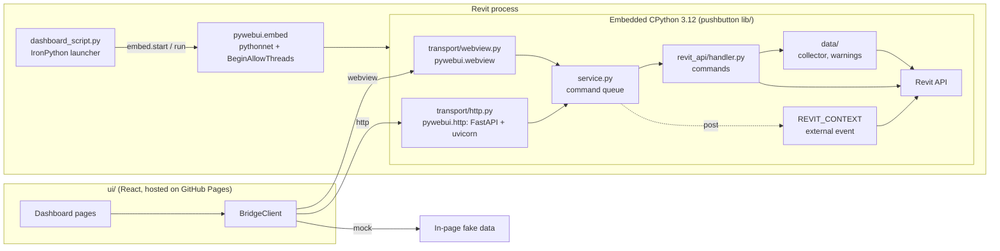
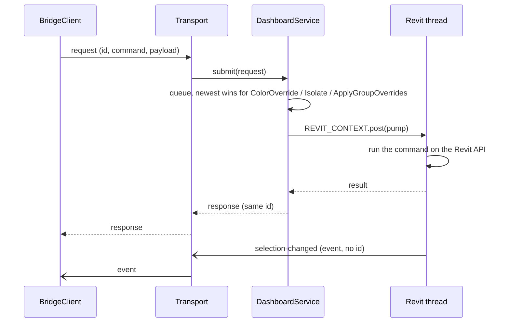
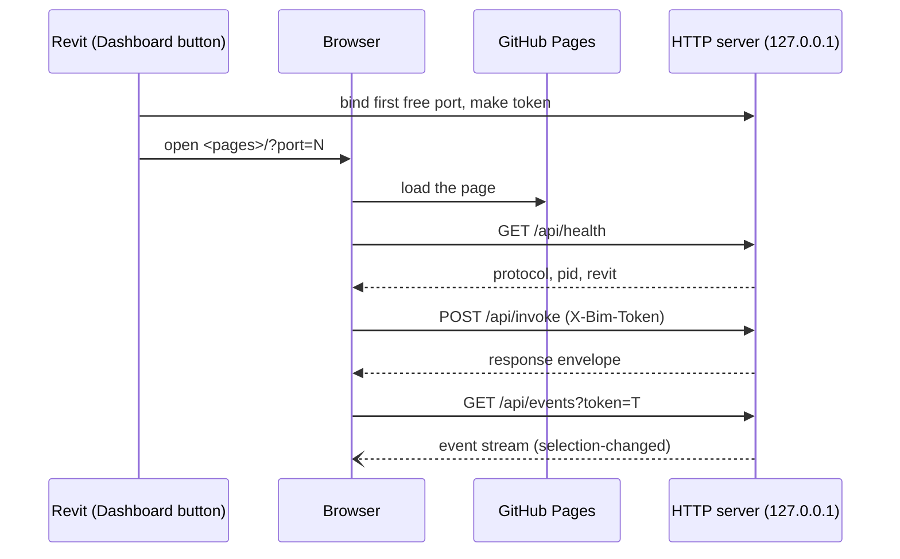

# pyrevit-webview-demo

A BIM dashboard for Revit with one React UI and one set of Revit logic, hosted two ways:

| Choice | Host | Transport |
|--------|------|-----------|
| **WebView2 window** | WPF window inside Revit | `chrome.webview.postMessage` in, `bim-bridge` CustomEvent out |
| **Browser** | Your default browser | `POST /api/invoke` and Server-Sent Events on `127.0.0.1:<8765-8774>` |

One **Dashboard** button asks which one to open.

## Architecture

### Components



The button script is a thin IronPython launcher. pyRevit's own `#! python3` engine
initializes CPython once and never releases the GIL (no `PythonEngine.BeginAllowThreads()`),
which starves every background thread, so the uvicorn server answered in bursts with stalls
of many seconds. The launcher calls `pywebui.embed`, which loads pyRevit's pythonnet
DLL and initializes the `CPY312` interpreter itself with `BeginAllowThreads`; the dashboard
code then runs inside it and its threads keep running after the click.

The transports come from the [pyWebUI](https://github.com/trgiangv/pyrevit-webview) lib (`pywebui.webview`, `pywebui.http`) and only move envelopes. Commands are registered on a `pywebui.Bridge`. `service.py` and everything below it never
know which transport asked. `mock` is used when the page runs in a plain
browser with no Revit.

### Envelope

Every message on both transports has the same shape:

| Field | Meaning |
|-------|---------|
| `type` | `request`, `response` or `event` |
| `command` | Command name, for example `GetSnapshot` or `Select` |
| `id` | Pairs a response to its request. Events have none |
| `payload` / `error` | Result on success, message on failure |

Commands are registered once on a `Bridge` in `revit_api/handler.py`: `GetSnapshot`, `Select`,
`Zoom`, `Isolate`, `ResetIsolation`, `ColorOverride`, `ClearOverrides`,
`IsolateByLevelCategory`, `CreateWarningView`, `ApplyGroupOverrides`,
`ResetScheduleMode`, `GetElementParameters`. A host can add commands only it can
serve with `bridge.add`, such as `SaveWorkbook` (native Save dialog) on WebView2.

### One request



`DashboardService` runs one command at a time on the Revit thread. A dropped
request is answered at once so its promise settles.

### Browser transport



- **Session binding.** Each Revit session binds the first free port of
  `8765-8774` and makes its own token, so several Revit sessions (other PIDs or
  versions) can run at once. A tab talks to the one it was opened from.
- **Token.** It travels in the URL fragment, so the page host never receives it.
  The page keeps it in `sessionStorage` for reloads.
- **Protocol check.** The page compares `protocol` from `/api/health` with its
  own (`ui/src/lib/session.ts`, `config.PROTOCOL`) and shows an error if they
  differ. Bump both when the contract changes.
- **Access control.** The server listens on loopback only, answers CORS for the
  page's origin alone, rejects other `Origin` and `Host` values, and requires the
  token on `/api/invoke` and `/api/events`. Chrome may ask permission before a
  public page reaches the local network.
- **Connection window.** Choosing Browser opens a small window that owns the
  server and shows how many browsers are connected. Closing it stops the server.

### WebView2 transport

The window navigates to the page. Requests go through `chrome.webview.postMessage`;
replies and events return as a `bim-bridge` CustomEvent. A snapshot with many rows is
sent as `snapshot-rows` events in chunks of 250.

## Layout

The repo root is the pyRevit search path.

```
pyrevit-webview-demo.extension/
    Dashboard.tab/Dashboard.panel/Dashboard.pushbutton/
        dashboard_script.py  IronPython launcher: TaskDialog, then pywebui.embed
        bundle.yaml
        icon.png
        lib/
            config.py      mode, page URLs, ports, protocol version, embed paths
            service.py     command queue shared by both transports
            log.py         file and stdout logging
            singleton.py   keeps the open windows
            windows.py     plain WPF window owned by Revit
            constants.py
            data/          element and warning collection
            revit_api/     command handlers
            transport/     webview.py, http.py
    startup.py             IronPython: installs the dashboard packages for the CPython engine
    ui/                    React app, built and published by CI
    extension.json
```

## Setup (once)

1. `pyrevit extend lib pyWebUI https://github.com/trgiangv/pyrevit-webview.git`
2. `pyrevit extensions paths add <repo root>`, then reload pyRevit.
3. `cd pyrevit-webview-demo.extension/ui && vp install`
4. For the editor: `pixi install`, then use `.pixi/envs/default/python.exe` as the interpreter.

Both choices run in the pyRevit `CPY312` engine. On pyRevit, `startup.py` (IronPython) checks it at load on a background thread. `pywebui.runtime.HTTP_REQUIREMENTS` (PEP 508 strings, the PEP 723 dependency form: `fastapi>=0.162.0`, `uvicorn>=0.54.0` and `packaging>=26.3`) must be installed, satisfy their specifiers and import. If any is missing, outside its specifier or broken, it installs them again with `pip install --target` into a staging folder and swaps it into `%LOCALAPPDATA%\pyWebUI\packages\pywebui\cp312` only after the check passes, so the engine's own `site-packages`, shared with other extensions, is never touched. The result is in the pyRevit log. `lib/config.py` (`embed_paths`) finds pyRevit's `pyRevitLabs.PythonNet.dll` (`netcore` on Revit 2025+, `netfx` before), the engine folder and `python312.dll`, and puts the button folder, `pyWebUI.lib` and that packages folder on the embedded interpreter's `sys.path`.

`pyproject.toml` sets up the same Python and packages with pixi for the editor.

### Limitations

- The dashboard must be the first Python runtime started in the Revit session. If another script already started pythonnet without `BeginAllowThreads`, `embed.start` raises and Revit must be restarted.
- `lib.*` and `pywebui.*` stay cached in the embedded interpreter, which lives as long as Revit. Restart Revit after editing them; reloading pyRevit is not enough.
## Run

The UI is not shipped with the tool. `MODE` in `lib/config.py` picks where the page
comes from (a `pywebui.Site`). It is a constant in the code, not an environment
variable; edit it and restart Revit:

| Mode | Page | WebView2 | Browser |
|------|------|----------|---------|
| `Mode.SERVER` (default) | GitHub Pages (`config.PAGES_URL`) | navigates to it | opens it, CORS for its origin |
| `Mode.DEV` | `http://localhost:5173` (Vite) | navigates to it, DevTools and CDP on | opens it, CORS for its origin |
| `Mode.LOCAL` | `ui/dist`, built by `vp build` | host `pywebui.local` mapped to the folder | the local server serves it at `/`, one origin, no CORS |

`Mode.LOCAL` fails with a clear error when `ui/dist/index.html` is missing. It needs no
network and keeps the UI and the Python side on the same version.

- **Server:** click **Dashboard**. Nothing to build locally.
- **Dev:** run `vp dev` in `ui/`, set `MODE = Mode.DEV`, restart Revit, click **Dashboard**.
- **Local:** run `vp build` in `ui/`, set `MODE = Mode.LOCAL`, restart Revit, click **Dashboard**.
## Logs

The dashboard writes to `%TEMP%\revit_dashboard.log`. After a button script
returns, pyRevit no longer shows stdout, so use the file.
`REVIT_DASHBOARD_LOG=DEBUG` adds per-category counts.

## CI

`.github/workflows/pages.yml` runs `vp check` and `vp build` with
`voidzero-dev/setup-vp` and deploys `ui/dist` to GitHub Pages on `main`. Set
Pages to **GitHub Actions** in the repository settings.

## Notes

- Export: WebView2 uses a native Save dialog (`SaveWorkbook`); the browser saves by itself.
- The UI toolchain is Vite+ (`vp install | dev | build | check | test`), with
  versions pinned in `ui/pnpm-workspace.yaml`.
- The embed path is not yet tested in Revit.

## Decisions

- [ADR-0001: browser to Revit architecture (Vietnamese)](docs/adr/0001-browser-revit-architecture.md): runtime, transport, security, AI direction, backlog and pitfalls.
